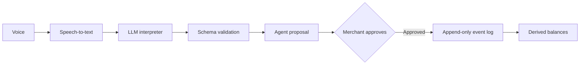

# Voice Ledger

A voice-first credit book for small merchants. A shopkeeper speaks naturally in their own language (including Hinglish), reviews a proposed transaction, and keeps a reliable record without stopping to write.

**The AI proposes; the application owns the books.** The language model only turns speech into a structured intent. It never writes to the ledger, approves anything, or computes a balance.

<!-- Add a screenshot or 1-2 minute demo GIF of the voice → proposal → approval flow here. -->

## Why this exists

Small merchants run on informal credit (udhaar), and the record is usually a notebook or memory. Voice makes capture effortless, but LLMs make mistakes, and a ledger can't. This project uses an LLM for the messy part (understanding language) and keeps every financial guarantee in plain, testable code.

## How it works



1. Speech arrives as a transcript. Speech-to-text is an upstream input; the eval harness works on transcripts, not audio.
2. The interpreter returns a small JSON intent, validated against a strict schema (`src/ai/schema.js`). Anything invalid is treated as "didn't understand".
3. The application builds a proposal and reads it back to the merchant.
4. Only an explicit approval, bound to the exact proposal by a digest, can append an event.
5. Balances are never stored. They are derived by replaying the event log.

## Features

- **8 reply languages:** English, Spanish, French, Hindi, Hinglish, Indonesian, Portuguese and Swahili.
- **Three approval tiers:** quick confirm for credits, payments and opening a dispute; full digest-echo approval for corrections and dispute resolution.
- **FIFO payment allocation, dispute-aware overdue tracking, and a full audit history per customer.**
- **Three interfaces over one core:** an HTTP API, a React web simulator, and an MCP server.

## Safety design

- The model never touches money. It outputs an intent; the app does everything else.
- Approval is bound to the exact proposal content by a digest, and only the approval path can append an event.
- The event log is append-only and events are deep-frozen. A correction is a new event.
- Ledger invariants are checked in unit tests and in every evaluation run. **Zero invariant violations and zero unapproved writes across every recorded run.**

### Ledger invariants

1. Balance is derived by replaying the event log, never stored. Two independent computations must agree.
2. Events are immutable. A correction is a new event pointing at the original.
3. A correction must reference an existing credit.
4. A dispute contributes zero to the balance. A claim is never turned into a payment.
5. Nothing is written without `approve()`. Corrections and dispute resolution require the proposal digest.
6. Committed content hashes to the approved content, and a dry-run replay happens before every write.
7. Payments are allocated oldest-credit-first (FIFO). The due date is the earliest unpaid credit.
8. Overdue is computed by code from the past-due unpaid amount, excluding disputed amounts. The LLM never decides it.

## Quick start (no AWS key needed)

**Prerequisites:** Node.js 20+ and npm. The LLM-backed API and LLM evaluations additionally need Amazon Bedrock access (bearer token, region, model ID). The mock interpreter, all tests and the verification suite run without Bedrock.

```sh
git clone https://github.com/adrish-mage/voiceLedger.git
cd voiceLedger
npm ci
cp .env.example .env
```

```sh
npm run dev                        # API on :3000 (mock interpreter unless INTERPRETER=llm)
```

```sh
cd web && npm ci && npm run dev    # React web simulator (proxies /api to :3000)
```

```sh
npm run mcp                        # MCP server on :3001/mcp
```

```sh
npm test                           # 38 unit and integration tests
npm run verify                     # full verification suite (API flow, MCP, web build, secret scan, leak check)
npm run demo                       # scripted demo
```

To use the Bedrock-backed interpreter, set the AWS and model values in `.env`, set `INTERPRETER=llm`, then use `npm run dev:llm` or `npm run verify:llm`.

## MCP server

A Streamable HTTP MCP server exposes the ledger to any MCP client, with bearer-token auth, origin checks, and the same digest gate as the API. Proposal tools never write; only `approve_proposal` with the exact digest does.

| Tool | Purpose |
|---|---|
| `list_customers`, `get_balance`, `list_overdue`, `get_audit` | Read-only queries |
| `propose_credit`, `propose_payment`, `propose_correction`, `propose_dispute` | Create a proposal and a spoken read-back (no write) |
| `approve_proposal`, `reject_proposal` | Commit or discard a pending proposal using its digest |

Full setup, HTTPS tunnel and Inspector instructions are in [`docs/MCP.md`](docs/MCP.md).

## Evaluation

The interpreter is evaluated on transcripts with a reproducible harness (`eval/run.js`): a 27-case development set used for prompt tuning, and three 16-case holdout sets (75 cases total). `scripts/check-leak.mjs` verifies that no full evaluation sentence appears in the model prompt. Every run also checks the ledger invariants and counts any write that wasn't approved.

**Cases passed, one number per recorded run.** Every cell shows 0 invariant violations and 0 extra-write cases.

*Initial prompt:*

| Interpreter | Dev (27) | Holdout v1 (16) |
|---|---|---|
| Mock (rules only) | 15 | 5 |
| GLM 4.7 Flash | 23 / 24 / 23 | 12 / 12 / 12 |
| gpt-oss-20b | 27 / 25 / 27 | 13 / 12 / 13 |

*Current prompt (GLM 4.7 Flash), after fixes for failures found in the runs above:*

| Set | Mock (rules only) | GLM 4.7 Flash |
|---|---|---|
| Dev (27) | 15 | 24 / 24 |
| Holdout v1 (16) | 5 | 13 |
| Holdout v2 (16) | 1 | 10 / 11 |
| Holdout v3 (16) | 2 | 15 / 15 / 16 |

How to read this: accuracy varies by set (v2 is the hardest), and the holdouts are small, so treat the numbers as indicative rather than definitive. Holdout v1 was run before the prompt revisions and informed them, which is why v2 and v3 were written afterward. The point of the design is that a wrong interpretation fails safe: it can produce a bad proposal that the merchant rejects, but it can never produce an unapproved or invariant-breaking write.

Raw per-run output is in `eval/results/` and `eval/results-v1/`.

### Reproduce

Run from the repo root. PowerShell shown; in bash use `INTERPRETER=mock CASES=eval/cases.json node eval/run.js`.

```powershell
# Rules-only baseline
$env:INTERPRETER = 'mock'
$env:CASES = 'eval/cases.json';           node eval/run.js
$env:CASES = 'eval/cases.holdout.json';   node eval/run.js

# LLM: set BEDROCK_MODEL_ID in .env (GLM 4.7 Flash or gpt-oss-20b)
$env:INTERPRETER = 'llm'
$env:CASES = 'eval/cases.json';           node --env-file=.env eval/run.js
$env:CASES = 'eval/cases.holdout2.json';  node --env-file=.env eval/run.js
$env:CASES = 'eval/cases.holdout3.json';  node --env-file=.env eval/run.js
```

## Project map

| File | Purpose |
|---|---|
| `src/ledger/reducer.js` | Pure function: replays events into balances, FIFO allocation, disputes, overdue status |
| `src/ledger/approval.js` | Approval tiers and digest binding |
| `src/ledger/service.js` | Proposals and approvals. The only path that writes events |
| `src/ledger/store.js` | Append-only store (in-memory or JSONL); events are deep-frozen |
| `src/ledger/validate.js` | Input validation |
| `src/agent.js` | Transcript → intent → proposal → confirmation → approve; holds conversation state |
| `src/ai/schema.js` | Validated JSON contract for interpreter output |
| `src/ai/interpret.llm.js` | Bedrock interpreter prompt and response handling |
| `src/ai/interpret.mock.js` | Rule-based stand-in for tests and the no-key quick start |
| `src/i18n/messages.js` | Reply templates for the 8 languages |
| `src/api/server.js` | HTTP API for the web simulator |
| `src/mcp/ledger.js` | MCP server with 10 tools |
| `web/` | React + Vite web simulator |
| `eval/run.js` | Evaluation harness: cases → pass/fail plus invariant checks |
| `scripts/verify-all.mjs` | One-command verification: tests, API flow, MCP, web build, secret scan |
| `FRICTION_LOG.md` | Real issues hit while building (Bedrock, model behavior, Alexa+ tooling) |

## How this was built

I used AI to plan the build, break it into steps and shape the design, and GitHub Copilot to speed up coding. The initial project scaffold was AI-generated. I wrote the LLM integration layer myself (prompt, schema contract, response handling and the connection to the ledger logic) and built the evaluation harness to measure the model rather than trust it.

## Known limitations

- Swahili dispute phrasing is unreliable on small models; the application fails safe.
- Item names that match the alias list are shown in English in replies.
- Non-English reply templates have not been reviewed by native speakers.
- Single shop, no login for the web app.
- Whole currency units only (no paise).
- Customer matching is exact or prefix only, with no fuzzy matching.
- In a fresh session, a correction that doesn't name the customer asks "Kis customer ke liye?" instead of inferring one (safe, but a design choice to revisit).
- FIFO allocates by total payments and does not model a payment made before a later credit.
- Not verified on a physical Alexa+ device. The MCP server is tested with the MCP Inspector, an automated protocol test and a web simulator; a direct Alexa+ connection is unverified (the Alexa AI CLI is not publicly available, see `FRICTION_LOG.md`).

## License

MIT (see [LICENSE](LICENSE)).
