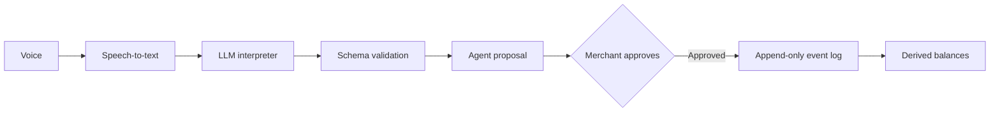

# Voice Ledger

A voice-first credit book for small merchants. A shopkeeper speaks naturally in their own language (including Hinglish), reviews a proposed transaction, and keeps a reliable record without stopping to write.

**The AI proposes; the application owns the books.** The language model only turns speech into a structured intent. It never writes to the ledger, approves anything, or computes a balance.

<!-- Add a screenshot or 1-2 minute demo GIF of the voice → proposal → approval flow here. -->

## Why this exists

Small merchants run on informal credit (udhaar), and the record is usually a notebook or memory. Voice makes capture effortless, but LLMs make mistakes, and a ledger can't. This project explores how to use an LLM for the messy part (understanding language) while keeping every financial guarantee in plain, testable code.

## How it works



1. The merchant's speech arrives as a transcript (speech-to-text is an upstream input; the eval harness works on transcripts, not audio).
2. The interpreter returns a small JSON intent, validated against a strict schema in `src/ai/schema.js`. Anything invalid is treated as "didn't understand".
3. The application builds a proposal and shows it to the merchant.
4. Only an explicit approval, bound to the exact proposal by a digest, can append an event.
5. Balances are never stored. They are derived by replaying the event log.

## Safety design

- The model never touches money. It outputs an intent; the app does everything else.
- Approval is bound to the exact proposal content by a digest, and only the approval path can append an event.
- The event log is append-only and events are immutable. A correction is a new event.
- Ledger invariants are checked in unit tests and in every evaluation run. The reported safety result is **0 invariant violations** across all recorded runs.

### Ledger invariants

1. Balance is derived by replaying the event log, never stored. Two independent computations must agree.
2. Events are immutable. A correction is a new event pointing at the original.
3. A correction must reference an existing credit.
4. A dispute contributes zero to the balance. A claim is never turned into a payment.
5. Nothing is written without `approve()`. Corrections and dispute resolution require the proposal digest.
6. Committed content hashes to the approved content, and a dry-run replay happens before every write.
7. Payments are allocated oldest-credit-first (FIFO). The due date is the earliest unpaid credit.
8. Overdue is computed by code from the past-due unpaid amount, excluding disputed amounts. The LLM never decides it.

## Quick start (no AWS key needed)

**Prerequisites:** Node.js 20+ and npm. The LLM-backed API and LLM evaluations additionally need Amazon Bedrock access (AWS bearer token, region, model ID). The mock interpreter and all ledger tests run without Bedrock.

```sh
git clone https://github.com/adrish-mage/voiceLedger.git
cd voiceLedger
npm ci
cp .env.example .env
```

With `INTERPRETER` unset, the API uses the rule-based mock interpreter:

```sh
npm run dev            # API, from the repo root
```

```sh
cd web && npm ci && npm run dev   # web simulator, in a second terminal
```

```sh
npm run mcp            # MCP server, in a third terminal
```

Run the tests and verification suite:

```sh
npm test               # unit tests
npm run verify         # full verification suite
```

To use the Bedrock-backed interpreter, set the AWS and model values in `.env`, set `INTERPRETER=llm`, then use `npm run dev:llm` or `npm run verify:llm`.

## Evaluation

The interpreter is evaluated on **43 transcripts**: a 27-case development set used for prompt tuning, and a 16-case holdout set that was written before tuning and never used to tune. `scripts/check-leak.mjs` verifies that no full evaluation sentence appears in the model prompt. The holdout is the headline number; the development set is for tuning and comparison.

Cases passed per run (three recorded runs per LLM, raw output in `eval/results/*.txt`):

| Interpreter | Dev set (27) | Holdout (16) | Invariant violations | Extra-write cases |
|---|---|---|---:|---:|
| Mock (rules only, single run) | 15 | 5 | 0 | 0 |
| GLM 4.7 Flash | 23 / 24 / 23 | 12 / 12 / 12 | 0 | 0 |
| gpt-oss-20b | 27 / 25 / 27 | 13 / 12 / 13 | 0 | 0 |

How to read this: the interpreter is imperfect on hard phrasings (best holdout 13/16), but when it misunderstands, the application fails safe. No run produced an invariant violation or an unapproved write. The holdout is small (16 cases), so treat the accuracy numbers as indicative rather than definitive.

### Reproduce

Run from the repo root. PowerShell shown; in bash use `INTERPRETER=mock CASES=eval/cases.json node eval/run.js`.

```powershell
# Rules-only baseline: dev, then holdout
$env:INTERPRETER = 'mock'
$env:CASES = 'eval/cases.json';          node eval/run.js
$env:CASES = 'eval/cases.holdout.json';  node eval/run.js

# LLM: set BEDROCK_MODEL_ID in .env (GLM 4.7 Flash or gpt-oss-20b),
# then run each dataset three times per model
$env:INTERPRETER = 'llm'
$env:CASES = 'eval/cases.json';          node --env-file=.env eval/run.js
$env:CASES = 'eval/cases.holdout.json';  node --env-file=.env eval/run.js
```

## Project map

| File | Purpose |
|---|---|
| `src/ledger/reducer.js` | Pure function: replays events into balances, FIFO allocation, disputes, overdue status |
| `src/ledger/approval.js` | Approval tiers and digest binding |
| `src/ledger/service.js` | Proposals and approvals. The only path that writes events |
| `src/ledger/store.js` | Append-only store (in-memory or JSONL); events are deep-frozen |
| `src/ledger/validate.js` | Input validation |
| `src/agent.js` | Transcript → intent → proposal → confirmation → approve; holds conversation state |
| `src/ai/schema.js` | Validated JSON contract for interpreter output |
| `src/ai/interpret.llm.js` | Bedrock interpreter prompt and response handling |
| `src/ai/interpret.mock.js` | Rule-based stand-in used for tests and the no-key quick start |
| `src/api/server.js` | HTTP API for the web simulator |
| `src/mcp/` | MCP server |
| `eval/run.js` | Evaluation harness: cases → pass/fail plus invariant checks |

## How this was built

I used AI to plan the build, break it into steps and shape the design, and GitHub Copilot to speed up coding. I wrote the LLM integration layer myself (prompt, schema contract, response handling, and the connection to the ledger logic), and built the evaluation harness to measure the model rather than trust it.

## Known limitations

- Swahili dispute phrasing is unreliable on small models; the application fails safe.
- Item names that match the alias list are shown in English in replies.
- Non-English reply templates have not been reviewed by native speakers.
- Single shop, no authentication or login.
- Whole currency units only (no paise).
- Customer matching is exact or prefix only, with no fuzzy matching.
- In a fresh session, a correction that doesn't name the customer asks "Kis customer ke liye?" instead of inferring one (safe, but a design choice to revisit).
- Opening a dispute needs one extra confirmation ("Haan").
- FIFO allocates by total payments and does not model a payment made before a later credit.
- Not verified on a physical Alexa+ device. Tested only with the MCP Inspector and a web simulator; the direct Alexa+ connection is unverified.

## License

MIT (see [LICENSE](LICENSE)).
