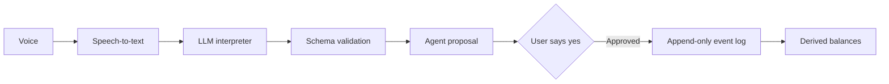

# Voice Ledger

Voice Ledger is a voice credit book for small merchants, in any language: a shopkeeper speaks naturally, reviews a proposed transaction, and keeps a reliable record without stopping to write. **The AI proposes; the application owns the books.**

## Architecture



## Prerequisites

- Node.js 20 or newer and npm.
- For the LLM-backed API and LLM evaluations: Amazon Bedrock access, an AWS bearer token, region, and model ID. The mock interpreter and ledger tests do not require Bedrock.
- Speech-to-text is an upstream input to this prototype; the eval harness evaluates transcripts, not audio.

## Setup and run

From the repository root:

```powershell
npm i
Copy-Item .env.example .env
```

Fill in the Bedrock settings in `.env`, then start the LLM-backed API:

```powershell
npm run dev:llm
```

In another terminal, start the web simulator:

```powershell
cd web
npm i
npm run dev
```

To start the hello-world MCP server, the currently defined command is `npm run mcp:hello`. The requested `npm run mcp` command is not currently defined in `package.json`. Run the tests from the repository root with `npm test`.

### Evaluations

`npm run eval` runs the sample transcript set using the mock interpreter. To run the dev set or holdout set with the LLM interpreter, set `CASES` and `INTERPRETER` before starting Node. In PowerShell:

```powershell
$env:CASES = 'eval/cases.json'
$env:INTERPRETER = 'llm'
node --env-file=.env eval/run.js

$env:CASES = 'eval/cases.holdout.json'
node --env-file=.env eval/run.js
```

Select the model using `BEDROCK_MODEL_ID` in `.env` before each run. The dev set was used for prompt tuning; the holdout set was not used for prompt tuning.

## Safety design

The model only interprets the transcript into a schema-validated intent. It never writes events, approves a proposal, or computes a balance. The application creates the proposal; approval is bound to the exact proposal content by a digest, and only the approval path can append an event. Balances are derived by replaying the append-only event log. Ledger invariants are checked in tests and evaluations; the target and reported safety result is **0 invariant violations**.

## Evaluation results

Fill in the measured results after running each model. Use the same metrics for both sets; do not infer values from a partial run.

| Interpreter / model | Dev set (pass / total; accuracy) | Dev invariant violations | Holdout set (pass / total; accuracy) | Holdout invariant violations |
|---|---:|---:|---:|---:|
| Mock | — | — | — | — |
| GLM 4.7 Flash | — | — | — | — |
| gpt-oss-20b | — | — | — | — |

## Ledger invariants

1. Balance is derived by replaying the event log, never stored. Two independent computations must agree.
2. Events are immutable. A correction is a new event pointing at the original.
3. A correction must reference an existing credit.
4. A dispute contributes zero to the balance. A claim is never turned into a payment.
5. Nothing is written without `approve()`. Corrections and dispute resolution require the proposal digest.
6. Committed content hashes to the approved content, and a dry-run replay happens before every write.
7. Payments are allocated oldest-credit-first (FIFO). The due date is the earliest unpaid credit.
8. Overdue is computed by code from the past-due unpaid amount, excluding disputed amounts.

## Project map

| File | Purpose |
|---|---|
| `src/ledger/reducer.js` | Replays events into balances, FIFO allocation, disputes, and overdue status. |
| `src/ledger/approval.js` | Approval tiers and digest binding. |
| `src/ledger/service.js` | Proposals and approvals; the only path that writes events. |
| `src/ledger/store.js` | Append-only in-memory or JSONL event store. |
| `src/ai/schema.js` | Validated JSON contract for interpreter output. |
| `src/ai/interpret.llm.js` | Bedrock interpreter prompt and response handling. |
| `eval/run.js` | Transcript evaluation harness and invariant checks. |

## Known gaps

- Whole rupees only; no paise yet.
- The mock interpreter only understands the demo phrasings.
- Customer matching is exact/prefix only, with no fuzzy matching.
- Only the hello-world MCP server exists; the eight real tools are not wrapped yet.
- Alexa+ device connection is unverified. The hello server completed a local MCP handshake reporting protocol 2025-11-25, which does not demonstrate Alexa+ connectivity. Current submission path is a self-hosted MCP server plus Alexa-style simulator.
- No authentication; single shop owner.

## License

MIT (see LICENSE).

## Map of the code

| File | What it is | Who should own it |
|---|---|---|
| `src/ledger/reducer.js` | Replays events → balance, FIFO allocation, disputes, overdue. Pure function. | **You (read line by line)** |
| `src/ledger/approval.js` | Approval tiers + digest binding an approval to exact content | **You** |
| `src/ledger/service.js` | `propose*()` then `approve()`. The only code path that writes events | **You** |
| `src/ledger/store.js` | Append-only store (memory or JSONL file). Events are deep-frozen | AI-generated is fine; swap for MongoDB later |
| `src/ledger/validate.js` | Input validation | review |
| `src/agent.js` | Transcript → intent → proposal → "haan" → approve. Holds conversation state | review |
| `src/ai/schema.js` | The JSON contract the LLM must return, validated by hand | **You** |
| `src/ai/interpret.mock.js` | Rule-based stand-in for the AI. Only knows demo phrasings | throwaway |
| `src/ai/interpret.llm.js` | Prompt + skeleton. **This is where real AI integration goes (Day 2)** | you + AI |
| `src/api/server.js` | HTTP API for the simulator | AI-generated is fine |
| `src/mcp/hello.js` | Hello-world MCP server for the Alexa+ connection test | AI-generated is fine |
| `eval/run.js` | Eval harness (cases → pass/fail + invariant violations) | **You** |

## Ledger invariants (enforced in code, tested)

1. Balance is derived by replaying the event log, never stored. Two independent computations must agree.
2. Events are immutable. A correction is a new event pointing at the original.
3. A correction must reference an existing credit.
4. A dispute contributes ₹0 to the balance, always. A claim is never turned into a payment.
5. Nothing is written without `approve()`. Corrections and dispute resolution need the proposal digest (FULL_APPROVAL).
6. What gets committed hashes to what was approved (Invariant 7), and a dry-run replay happens before every write.
7. Payments are allocated oldest-credit-first (FIFO). Due date = earliest unpaid credit.
8. Overdue = past due date and unpaid, minus the disputed amount. Computed by code. The LLM never decides it.

## What "AI integration" means here

One function: `interpret(transcript, context) → intent JSON`. The model reads speech-as-text and returns a small
JSON object (`src/ai/schema.js`). The app validates it; anything invalid is treated as "didn't understand".
The model never touches money. See the steps at the top of `src/ai/interpret.llm.js`.

## Known gaps (decide, don't forget)

- Whole rupees only (no paise yet).
- The mock interpreter only understands the demo phrasings.
- In a fresh session, a correction without naming the customer asks "Kis customer ke liye?" (safe, but decide if it should infer).
- Opening a dispute is QUICK_CONFIRM per the plan, so the demo needs one extra "Haan" there.
- FIFO allocates by total payments; it does not model a payment made before a later credit.
- Customer matching is exact/prefix only, no fuzzy matching.
- Only the hello-world MCP server exists. The 8 real tools are not wrapped yet.
- **Alexa+ connection is UNVERIFIED.** The hello server completed a local MCP handshake reporting protocol 2025-11-25.
  That says nothing about Alexa+ reaching it.Submission path: self-hosted MCP server plus Alexa-style simulator. Direct Alexa+ device connection not achieved (UNVERIFIED).
- No authentication; single shop owner.

## License
MIT (see LICENSE). Edit the copyright line to your full legal name.
